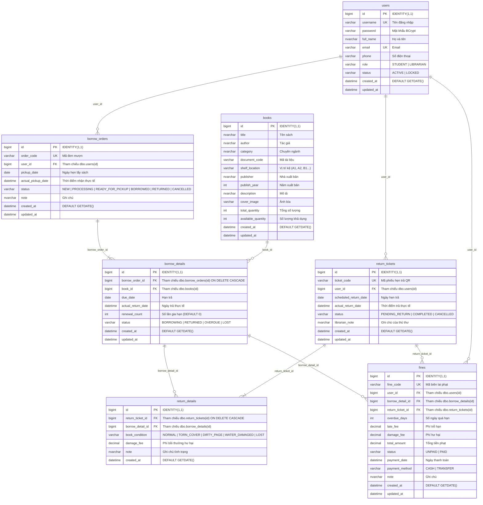

# HỆ THỐNG CƠ SỞ DỮ LIỆU SQL SERVER - THƯ VIỆN UTH

Tài liệu hướng dẫn khởi tạo CSDL **`library_db`** trên **Microsoft SQL Server (SSMS)** cho dự án **Hệ Thống Quản Lý Thư Viện Đại Học Giao Thông Vận Tải TP.HCM (UTH Library)**.

---

## 📁 Cấu trúc thư mục `database/`

| Tệp tin | Mô tả chức năng |
| :--- | :--- |
| **`schema.sql`** | Script T-SQL khởi tạo CSDL `library_db`, tạo 7 bảng (`dbo.*`) kèm ràng buộc `PRIMARY KEY`, `FOREIGN KEY`, `CHECK`, `DEFAULT`, `NONCLUSTERED INDEX` và dữ liệu mẫu cơ bản. |
| **`README.md`** | Tài liệu mô tả cấu trúc bảng, sơ đồ liên kết và hướng dẫn chạy script trên SSMS. |

---

## 🗄️ Cấu trúc 7 Bảng CSDL (`library_db`)

---

## 📋 Chi tiết các Bảng & Ràng buộc (`CHECK` / `INDEX`)

1. **`dbo.users`** (Tài khoản người dùng):
   - Ràng buộc `chk_user_role`: `role IN ('STUDENT', 'LIBRARIAN')`
   - Ràng buộc `chk_user_status`: `status IN ('ACTIVE', 'LOCKED')` (Mặc định `'ACTIVE'`)
   - Chỉ mục: `idx_user_username`, `idx_user_email`

2. **`dbo.books`** (Danh mục kho sách và tồn kho):
   - Quản lý số lượng qua `total_quantity`, `available_quantity`, mã tài liệu `document_code` và vị trí kệ `shelf_location`.
   - Chỉ mục: `idx_book_title`, `idx_book_author`, `idx_book_category`, `idx_book_document_code`

3. **`dbo.borrow_orders`** (Đơn đặt mượn sách trực tuyến):
   - Ràng buộc `chk_borrow_order_status`: `status IN ('NEW', 'PROCESSING', 'READY_FOR_PICKUP', 'BORROWED', 'RETURNED', 'CANCELLED')`
   - Khóa ngoại: `fk_borrow_order_user` (`user_id` -> `dbo.users.id`)
   - Chỉ mục: `idx_borrow_order_code`, `idx_borrow_order_user`, `idx_borrow_order_status`

4. **`dbo.borrow_details`** (Chi tiết từng cuốn sách trong đơn mượn):
   - Ràng buộc `chk_borrow_detail_status`: `status IN ('BORROWING', 'RETURNED', 'OVERDUE', 'LOST')`
   - Khóa ngoại: `fk_borrow_detail_order` (`ON DELETE CASCADE`), `fk_borrow_detail_book`
   - Chỉ mục: `idx_borrow_detail_order`, `idx_borrow_detail_book`, `idx_borrow_detail_status`, `idx_borrow_detail_due_date`

5. **`dbo.return_tickets`** (Phiếu hẹn trả sách sớm có mã QR):
   - Ràng buộc `chk_return_ticket_status`: `status IN ('PENDING_RETURN', 'COMPLETED', 'CANCELLED')`
   - Khóa ngoại: `fk_return_ticket_user` (`user_id` -> `dbo.users.id`)
   - Chỉ mục: `idx_return_ticket_code`, `idx_return_ticket_user`, `idx_return_ticket_status`

6. **`dbo.return_details`** (Chi tiết đối soát tình trạng sách khi trả):
   - Ràng buộc `chk_return_detail_condition`: `book_condition IN ('NORMAL', 'TORN_COVER', 'DIRTY_PAGE', 'WATER_DAMAGED', 'LOST')`
   - Khóa ngoại: `fk_return_detail_ticket` (`ON DELETE CASCADE`), `fk_return_detail_borrow`
   - Chỉ mục: `idx_return_detail_ticket`, `idx_return_detail_borrow`

7. **`dbo.fines`** (Biên lai thu phạt quá hạn và bồi thường hư hại):
   - Ràng buộc `chk_fine_status`: `status IN ('UNPAID', 'PAID')`
   - Ràng buộc `chk_fine_payment_method`: `payment_method IN ('CASH', 'TRANSFER')`
   - Khóa ngoại: `fk_fine_user`, `fk_fine_borrow_detail`, `fk_fine_return_ticket`
   - Chỉ mục: `idx_fine_code`, `idx_fine_user`, `idx_fine_status`

---

## 🧪 Dữ liệu mẫu đi kèm trong `schema.sql`

### 1. Tài khoản mẫu (`dbo.users`)

| Username             | Role          | Họ và tên       | Email                 | Trạng thái |
| :------------------- | :------------ | :----------------- | :-------------------- | :----------- |
| **`admin`**  | `LIBRARIAN` | Thủ Thư Trưởng | `admin@uth.edu.vn`  | `ACTIVE`   |
| **`sv2026`** | `STUDENT`   | Võ Hoàng Phúc   | `sv2026@uth.edu.vn` | `ACTIVE`   |

### 2. Kho sách mẫu (`dbo.books`)

| Mã tài liệu       | Tên sách                                       | Tác giả      | Chuyên ngành         | Vị trí kệ | Số lượng |
| :------------------- | :----------------------------------------------- | :------------- | :--------------------- | :----------: | :---------: |
| **`IT-001`** | Giáo Trình Cấu Trúc Dữ Liệu & Giải Thuật | Nguyễn Văn A | Công nghệ thông tin |    `A1`    |   10 / 10   |
| **`IT-002`** | Lập Trình Web với Spring Boot & React         | Trần Thị B   | Công nghệ thông tin |    `A2`    |    8 / 8    |
| **`GT-001`** | Kỹ Thuật Giao Thông Đô Thị Hiện Đại     | Lê Văn C     | Kỹ thuật giao thông |    `B1`    |    5 / 5    |

---

## 🚀 Hướng dẫn chạy trên SQL Server Management Studio (SSMS)

1. Mở **SQL Server Management Studio (SSMS)** và kết nối tới SQL Server Instance của bạn.
2. Vào menu **File** -> **Open** -> **File...** (hoặc nhấn `Ctrl + O`) và chọn file **`database/schema.sql`**.
3. Nhấn nút **Execute** (hoặc phím **`F5`**) để thực thi toàn bộ script.
4. Để xem sơ đồ liên kết các bảng (Database Diagram):
   - Trong **Object Explorer**, mở rộng **Databases** -> **`library_db`**.
   - Chuột phải vào **Database Diagrams** -> chọn **New Database Diagram** -> bôi chọn cả 7 bảng và bấm **Add**.
